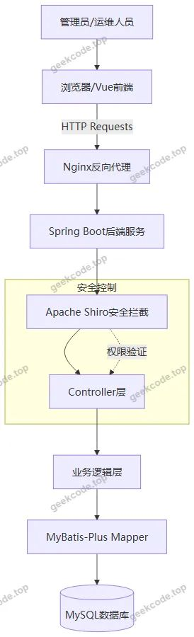
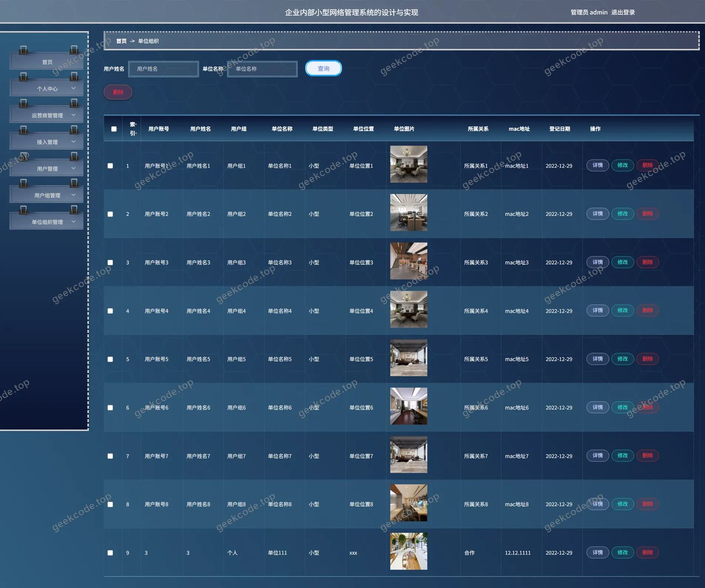
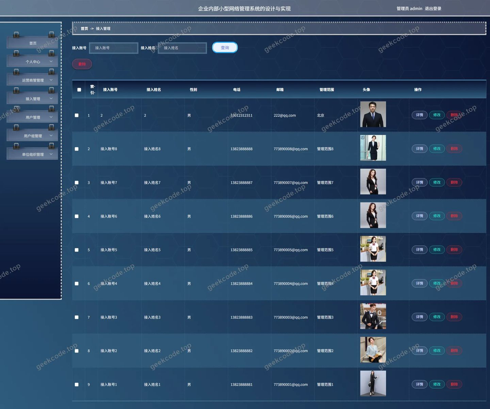
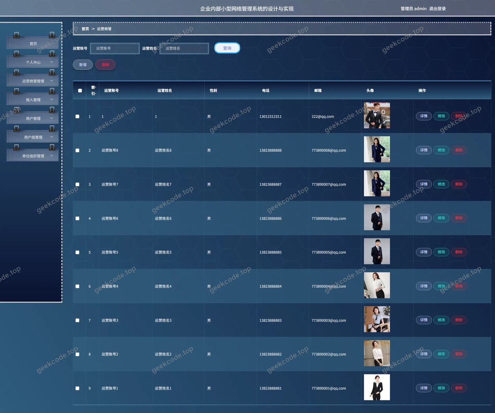

# 企业内部小型网络管理系统的设计与实现

> 🎓 **计算机毕业设计 · 企业内部小型网络管理系统的设计与实现**
>
> 本仓库只放**项目介绍 + 运行截图**（截图是站点带水印的原图，存在仓库 `images/` 里）。
>
> 👉 **完整可运行源码 / 数据库脚本 / 部署文档：[点我获取](https://geekcode.top/archives/%E4%BC%81%E4%B8%9A%E5%86%85%E9%83%A8%E5%B0%8F%E5%9E%8B%E7%BD%91%E7%BB%9C%E7%AE%A1%E7%90%86%E7%B3%BB%E7%BB%9F%E7%9A%84%E8%AE%BE%E8%AE%A1%E4%B8%8E%E5%AE%9E%E7%8E%B0?utm_source=github)**
>
> 💬 咨询微信：**ir9372**　|　🌐 更多项目：[极客代码 geekcode.top](https://geekcode.top/?utm_source=github)
>
> 📌 项目详情页：<https://geekcode.top/archives/%E4%BC%81%E4%B8%9A%E5%86%85%E9%83%A8%E5%B0%8F%E5%9E%8B%E7%BD%91%E7%BB%9C%E7%AE%A1%E7%90%86%E7%B3%BB%E7%BB%9F%E7%9A%84%E8%AE%BE%E8%AE%A1%E4%B8%8E%E5%AE%9E%E7%8E%B0?utm_source=github>

<table><td width="230" align="center"> <b>扫码加微信 ir9372</b></td><td valign="middle">📦 源码 = 项目介绍 + 全部运行截图 + 数据库 + 部署文档 👉 点上方任意截图，直接跳到 <b>极客代码 geekcode.top</b> 详情页</td></table>

---

<h1>企业内部小型网络管理系统的设计与实现</h1>
<h2>项目概述</h2>

本项目旨在设计并实现一套企业内部小型网络管理系统，以解决中小企业在内部网络资源管理、用户权限控制及组织架构维护方面的痛点。系统采用前后端分离架构，后端基于 Spring Boot 框架，前端采用 Vue 技术栈（vue-integrated），通过 RESTful API 进行数据交互。核心功能涵盖接入管理、运营商管理、单位组织维护、用户管理及用户组配置五大模块。系统主要面向企业 IT 管理员及网络运维人员，提供集中化的网络资源调度与权限分配能力。通过集成 Apache Shiro 安全框架，实现了细粒度的访问控制，确保企业网络数据的安全性与完整性，提升内部网络管理的效率与规范性。

<h2>技术架构</h2>

本系统采用典型的 B/S 架构模式，整体技术选型兼顾开发效率与运行稳定性。

<strong>1. 后端架构</strong>

<ul>
<li><strong>核心框架</strong>：使用 Spring Boot 作为基础应用框架，利用其自动配置特性简化部署流程。</li>
<li><strong>持久层</strong>：采用 MyBatis-Plus 作为 ORM 框架，结合 mysql-connector-java 驱动连接 MySQL 数据库。MyBatis-Plus 提供了通用的 CRUD 操作封装，显著减少了样板代码的开发量。</li>
<li><strong>安全框架</strong>：集成 Apache Shiro，负责身份认证（Authentication）与授权（Authorization）。Shiro 通过 Filter 和 Realm 机制拦截请求，保护后台管理接口不被未授权访问。</li>
<li><strong>其他依赖</strong>：引入 commons-lang3 处理通用工具类，validation-api 用于参数校验，protobuf-java 支持高效的数据序列化需求。</li>
</ul>

<strong>2. 前端架构</strong>

<ul>
<li><strong>视图层</strong>：基于 Vue.js 构建单页面应用（SPA），实现后台管理界面的动态渲染。</li>
<li><strong>通信机制</strong>：通过 Axios 或原生 Fetch API 调用后端 <code>/jieruguanli</code>、<code>/yonghu</code> 等路由接口获取数据。</li>
</ul>

<strong>3. 数据库设计要点</strong>

<ul>
<li>数据库主要存储实体关系数据，包括单位组织结构、用户账号信息、用户组定义、网络接入设备及运营商信息。表结构设计遵循第三范式，确保数据冗余最小化，并通过外键关联保证参照完整性。</li>
</ul>

<h2>功能模块</h2>

根据源码中的 Controller 列表及后台路由配置，系统仅包含后台管理端功能，无前台用户端界面。具体模块如下：

<h3>后台管理端</h3>
<ol>
<li><strong>登录页模块 (<code>admin</code>)</strong></li>
</ol>
<ul>
<li>提供管理员身份认证入口，输入用户名和密码后，经由 Shiro 框架验证合法性，成功后跳转至首页并颁发会话令牌。</li>
</ul>
<ol start="2">
<li><strong>接入管理模块 (<code>/jieruguanli</code>)</strong></li>
</ol>
<ul>
<li>对应 <code>JieruguanliController</code>。负责管理企业内部网络接入设备或接入点的基础信息，包括接入状态的监控、接入配置的增删改查，确保网络终端的可控性。</li>
</ul>
<ol start="3">
<li><strong>运营商管理模块 (<code>/yunyingshangguan</code>)</strong></li>
</ol>
<ul>
<li>对应 <code>YunyingshangguanController</code>。用于维护企业合作的电信运营商信息，如运营商名称、联系方式、服务套餐类型等，便于企业进行外部网络资源的统筹管理。</li>
</ul>
<ol start="4">
<li><strong>单位组织模块 (<code>/danweizuzhi</code>)</strong></li>
</ol>
<ul>
<li>对应 <code>DanweizuzhiController</code>。构建企业的树状或层级组织结构图，管理部门、科室等行政单元，为后续的用户归属和权限划分提供基础数据支撑。</li>
</ul>
<ol start="5">
<li><strong>用户管理模块 (<code>/yonghu</code>)</strong></li>
</ol>
<ul>
<li>对应 <code>YonghuController</code>。管理系统内的所有操作员账号，包括用户的创建、禁用、密码重置及基本信息修改。该模块是权限控制的主体对象。</li>
</ul>
<ol start="6">
<li><strong>用户组管理模块 (<code>/yonghuzu</code>)</strong></li>
</ol>
<ul>
<li>对应 <code>YonghuzuController</code>。定义不同的角色组（如超级管理员、普通运维、只读用户等），并将用户关联至特定组别，通过组策略批量分配访问权限，简化权限维护复杂度。</li>
</ul>
<ol start="7">
<li><strong>通用配置与文件模块</strong></li>
</ol>
<ul>
<li>对应 <code>CommonController</code>, <code>ConfigController</code>, <code>FileController</code>。提供系统全局参数配置、字典数据查询以及文件上传下载服务，支撑上述业务模块的正常运行。</li>
</ul>
<h2>用户角色与权限</h2>

基于 Apache Shiro 框架的设计，系统主要划分为以下角色，不同角色拥有差异化的功能访问权限：

<table>
<thead>
<tr>
<th align="left">角色名称</th>
<th align="left">描述</th>
<th align="left">可访问功能模块</th>
<th align="left">权限说明</th>
</tr>
</thead>
<tbody><tr>
<td align="left"><strong>超级管理员 (Admin)</strong></td>
<td align="left">系统最高权限持有者，通常由 IT 部门负责人担任。</td>
<td align="left"><strong>全部模块</strong>：1. 接入管理2. 运营商管理3. 单位组织4. 用户管理5. 用户组管理6. 系统配置</td>
<td align="left">拥有对所有数据的增、删、改、查权限；可以创建新的管理员账户；可以修改系统底层配置参数；拥有完整的审计和管理能力。</td>
</tr>
<tr>
<td align="left"><strong>普通运维人员</strong></td>
<td align="left">负责日常网络监控与维护的技术人员。</td>
<td align="left"><strong>受限模块</strong>：1. 接入管理 (查看/编辑)2. 用户管理 (查看)3. 单位组织 (查看)</td>
<td align="left">通常不具备“删除”高危数据的权限；无法修改“用户组”定义以防止权限滥用；对“运营商”和“系统配置”模块可能仅有只读或无访问权限，具体取决于 Shiro 的配置策略。</td>
</tr>
<tr>
<td align="left"><strong>未授权访客</strong></td>
<td align="left">未登录用户或被禁用的账户。</td>
<td align="left"><strong>无</strong></td>
<td align="left">仅能访问登录页面。任何尝试访问后台业务路由（如 <code>/yonghu</code>）的请求均会被 Shiro 过滤器拦截并重定向至登录页或返回 403 错误。</td>
</tr>
</tbody></table>

<em>注：具体细分权限粒度依赖于 Shiro Realm 中定义的 Permission 字符串规则，上述表格基于常规企业管理系统逻辑推导。</em>

<h2>项目特色与创新点</h2>
<ol>
<li><strong>轻量级安全整合</strong>：将 Apache Shiro 与 Spring Boot 深度集成，相比传统 Session 管理，提供了更灵活的认证授权机制，特别适用于企业内部封闭网络环境下的快速权限迭代。</li>
<li><strong>结构化数据治理</strong>：通过“单位组织”与“用户组”的双维模型，解决了传统扁平化用户管理中难以体现层级关系的痛点，使得网络权限分配能够紧密贴合企业实际行政架构。</li>
<li><strong>模块化网络管控</strong>：将“接入管理”与“运营商管理”独立拆分，实现了内网终端接入与外网线路资源的解耦管理，有助于企业在复杂网络环境下清晰界定责任边界，提升故障排查效率。</li>
<li><strong>高效开发实践</strong>：利用 MyBatis-Plus 的代码生成器特性，大幅缩短了标准 CRUD 功能的开发周期，使开发者能将更多精力集中在业务逻辑优化与安全策略制定上。</li>
</ol>
<h2>部署环境</h2>

为确保系统稳定运行，建议按照以下标准配置服务器环境：

<ul>
<li><strong>操作系统</strong>：Linux (CentOS 7+/Ubuntu 20.04+) 或 Windows Server 2016+</li>
<li><strong>Java 环境</strong>：JDK 1.8 或 JDK 11（需兼容 Spring Boot 版本）</li>
<li><strong>数据库</strong>：MySQL 5.7 或 MySQL 8.0（字符集建议设置为 utf8mb4 以支持完整 Unicode）</li>
<li><strong>Web 容器</strong>：内置 Tomcat（Spring Boot 默认）或外部 Nginx 用于静态资源托管及反向代理</li>
<li><strong>前端运行环境</strong>：Node.js v14+（用于前端 Vue 项目的编译打包，生产环境仅需编译后的静态 HTML/CSS/JS 文件）</li>
<li><strong>缓存组件</strong>：Redis（可选，若启用 Shiro 分布式 Session 管理则必需）</li>
</ul>
<h2>五、技术特性</h2>
<ul>
<li>前后端集成部署，前端资源打包至后端 static 目录</li>
<li>使用 MyBatis-Plus 简化数据访问层开发</li>
<li>集成 Shiro 权限框架实现角色权限控制</li>
</ul>
<h2>六、功能模块截图</h2>
<h3>后台管理端</h3>
<h4>后台-单位组织</h4>

<h4>后台首页</h4>

<h4>后台-接入管理</h4>

<h4>后台-登录</h4>

<h4>后台-运营商管</h4>

---

## 获取完整源码

| 项目 | 说明 |
| --- | --- |
| 项目名 | 企业内部小型网络管理系统的设计与实现 |
| 运行截图 | 本文 6 张（站点带水印原图，仓库 `images/` 目录） |
| 完整源码 | [https://geekcode.top/archives/%E4%BC%81%E4%B8%9A%E5%86%85%E9%83%A8%E5%B0%8F%E5%9E%8B%E7%BD%91%E7%BB%9C%E7%AE%A1%E7%90%86%E7%B3%BB%E7%BB%9F%E7%9A%84%E8%AE%BE%E8%AE%A1%E4%B8%8E%E5%AE%9E%E7%8E%B0?utm_source=github](https://geekcode.top/archives/%E4%BC%81%E4%B8%9A%E5%86%85%E9%83%A8%E5%B0%8F%E5%9E%8B%E7%BD%91%E7%BB%9C%E7%AE%A1%E7%90%86%E7%B3%BB%E7%BB%9F%E7%9A%84%E8%AE%BE%E8%AE%A1%E4%B8%8E%E5%AE%9E%E7%8E%B0?utm_source=github) |
| 咨询微信 | **ir9372**（备注：jingpin-yuanma） |
| 更多项目 | [极客代码 geekcode.top](https://geekcode.top/?utm_source=github) |

> 需要源码、部署、改配置、跑不起来等问题，加微信 ir9372 沟通，说明项目名即可。
